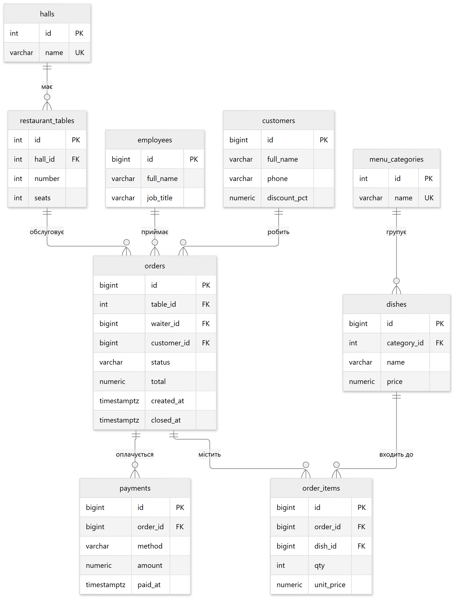
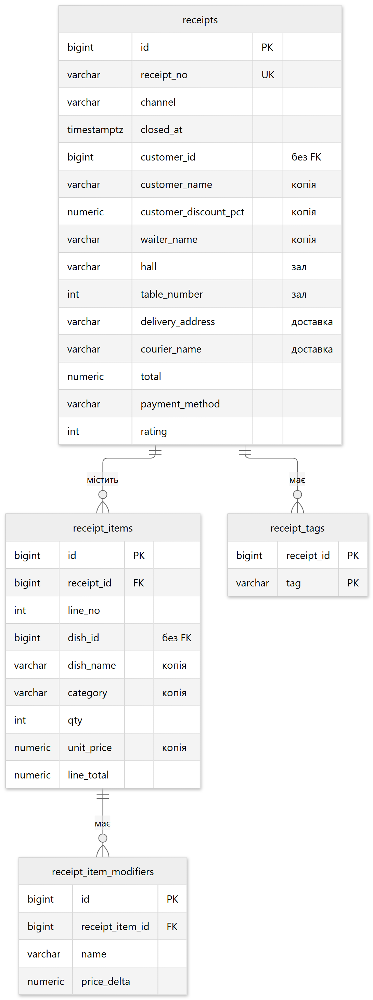

# Інформаційна система ресторану

Облік замовлень, оплат і чеків. Дані розподілені між трьома сховищами: PostgreSQL
тримає операційну частину, MongoDB — історію чеків, Redis — оперативні показники зміни.

## Предметна область

Ресторан з кількома залами. Гість або сідає за столик, або замовляє доставку чи самовивіз.
Офіціант відкриває замовлення, додає до нього страви з меню, після оплати замовлення
закривається — і на нього виписується чек.

Постійні клієнти мають персональну знижку, яка застосовується до суми замовлення
автоматично. Меню згруповане за категоріями, ціни змінюються з часом.

| Група | Сутності | Що описує |
|---|---|---|
| Приміщення | `halls`, `restaurant_tables` | зали та столики з місткістю |
| Меню | `menu_categories`, `dishes` | страви з цінами, згруповані за категоріями |
| Люди | `employees`, `customers` | офіціанти та клієнти з персональною знижкою |
| Продаж | `orders`, `order_items`, `payments` | замовлення, його позиції та оплата |
| Історія | `receipts`, `receipt_items`, `receipt_item_modifiers`, `receipt_tags` | чек, виписаний після оплати |

Межа між двома групами проходить по моменту оплати. Доки замовлення відкрите, воно живе
в операційних таблицях і постійно змінюється: додаються позиції, перераховується сума.
Щойно його оплатили — з нього народжується чек, який більше не змінюється і завжди
читається цілком. Саме ця різниця в характері доступу і стала підставою винести чек
в окреме сховище.

### Схема бази даних

**Операційна частина** — замовлення, яке живе й змінюється:



**Чек**:



На другій діаграмі показано ключові колонки; повний перелік — у `003-receipts-schema.sql`.

Дві групи таблиць не зв'язані між собою зовнішніми ключами, і це свідоме рішення:
`receipts.customer_id`, `receipts.waiter_id` та `receipt_items.dish_id` — звичайні числа,
а не посилання.

Замість посилань чек **копіює** потрібні дані в себе: не `dish_id`, за яким треба
підтягнути назву з меню, а одразу `dish_name` і `unit_price`; не `customer_id`,
а `customer_name` і `customer_discount_pct`. Після оплати ці значення вже ніколи
не змінюються.

Навіщо так. Нехай страва «Салат Цезар» коштує 210 грн, гість її замовив і оплатив.
Через місяць ресторан піднімає ціну до 260 грн і перейменовує страву на «Цезар з куркою».
Якби чек посилався на `dishes`, то старий чек почав би показувати нові назву й ціну —
сума в ньому перестала б збігатися з тим, що насправді заплатив гість. Чек — фінансовий
документ, він має назавжди лишатися таким, яким був виданий. Тому дані в нього
копіюються, а не підтягуються.

Та сама логіка стосується знижки клієнта, номера столика й імені офіціанта: усе це
записується в чек на момент оплати.

У робочій системі чеки зберігаються в MongoDB одним документом. Таблиці `receipts*` —
той самий чек, розкладений на реляційну модель, щоб було з чим порівнювати швидкодію.

### Де що зберігається

| Сховище | Що зберігає | Чому саме воно |
|---|---|---|
| PostgreSQL 16 | замовлення, позиції, оплати, меню, зали, клієнти | дані зв'язані, потрібні транзакції й цілісність |
| MongoDB 7 | чеки | чек читається й пишеться цілком, набір полів різний |
| Redis 7 | лічильники зміни, рейтинги, кеш чека | дані живуть години, читаються постійно, відновлювані |

Застосунок — Spring Boot 4 (Java 21). Міграції PostgreSQL — Liquibase (formatted SQL),
робота з реляційною БД із коду — Repository + Unit of Work через збережені процедури,
функції та розрізи даних.

## Запуск

Потрібен лише Docker — Java і Maven встановлювати не треба, застосунок збирається
всередині контейнера.

```bash
docker compose up -d --build
```

| Сервіс | URL | Примітка |
|---|---|---|
| REST API | http://localhost:8080/api/health | Liquibase накатує схему на старті, індекси MongoDB створюються там же |
| Adminer | http://localhost:8081 | сервер `postgres`, БД `restaurant_db`, користувач `restaurant_user`, пароль `restaurant_pass` |
| mongo-express | http://localhost:8082 | колекція `restaurant_nosql.receipts` |
| PostgreSQL | localhost:5433 | `restaurant_db` / `restaurant_user` / `restaurant_pass` |
| MongoDB | localhost:27017 | база `restaurant_nosql` |
| Redis | localhost:6379 | ключі з префіксом `restaurant:` |

Зупинка разом з даними:

```bash
docker compose down -v
```

Готові до запуску запити — `docs/requests.http`.

---

## Види NoSQL сховищ

| Тип | Модель даних | Сильна сторона | Слабка сторона | Де міг би стати у пригоді тут |
|---|---|---|---|---|
| Key-value (Redis, Memcached, DynamoDB) | ключ → значення, часто з часом життя | найшвидше читання за ключем, структури в пам'яті | немає запитів за вмістом значення | лічильники зміни, кеш чека, черга замовлень на кухню |
| Документне (MongoDB, Couchbase) | JSON/BSON-документ довільної вкладеності | складений запис зберігається цілком, набір полів може різнитися, індекси по вкладених полях | немає з'єднань, одні й ті самі назви повторюються в багатьох документах | чеки, картки страв з довільними характеристиками |
| Колонкове (Cassandra, HBase, ScyllaDB) | рядок → родини колонок, розподіл за ключем | лінійне масштабування запису, рядки з тисячами колонок, більшість з яких порожні | запити лише за наперед спроєктованим ключем | телеметрія обладнання кухні, потік подій POS-терміналів |
| Графове (Neo4j, JanusGraph) | вершини й ребра з властивостями | обхід зв'язків довільної глибини | неефективне для масових сканувань | рекомендації «цю страву беруть разом із», зв'язки постачальників |
| Пошукове (Elasticsearch, OpenSearch) | інвертований індекс документів | повнотекстовий пошук, фасети, ранжування | дорого тримати як джерело істини | пошук по меню, відгуках, описах страв |
| Часових рядів (TimescaleDB, InfluxDB) | метрика + час + теги | стиснення й агрегація по часових вікнах | вузька спеціалізація | температура холодильників, завантаженість залів по годинах |

Взято **документне** сховище як основне для винесених даних і **key-value** як друге.

## Що виносити в NoSQL

Винесення має сенс лише для тих даних, яким реляційна модель заважає. Тому спершу
перебрали всі сутності предметної області й подивилися, як кожна з них поводиться.

| Кандидат | Як поводиться | Рішення |
|---|---|---|
| Меню: `menu_categories`, `dishes` | десятки рядків, потрібна унікальність назв, бере участь у зв'язках із замовленнями | лишити в PostgreSQL |
| Зали та столики | невелика таблиця, майже не змінюється | лишити |
| Клієнти | потрібна унікальність телефону, знижка впливає на суму замовлення всередині транзакції | лишити |
| Відкриті замовлення: `orders`, `order_items` | змінюються постійно, кожна зміна перераховує суму, потрібні транзакції й відкат | лишити — це саме те, для чого існує реляційна БД |
| Оплати | фінансова операція, потрібна цілісність із замовленням | лишити |
| **Чеки закритих замовлень** | створюються раз і далі лише читаються, структура різна для різних каналів продажу, обсяг росте нескінченно | **винести в MongoDB** |

Отже, для винесення обрали **чек** — документ, що формується в момент оплати замовлення.

### Чому саме він

Окремої сутності «чек» у базі зараз немає. Щоб показати гостю або бухгалтерії один чек,
доводиться щоразу збирати дев'ять таблиць: `orders`, `order_items`, `dishes`,
`menu_categories`, `customers`, `employees`, `restaurant_tables`, `halls`, `payments`.
При цьому сам чек — цілісний документ, і саме так його сприймає і гість, і бухгалтер.

Шість причин, чому ця сутність лягає на документну модель краще, ніж на реляційну:

1. **Чек не змінюється, а меню й дані клієнтів — змінюються.** У позиції замовлення
   зберігається ціна на момент продажу, але назва страви, знижка клієнта, номер столика
   й назва залу щоразу беруться з таблиць `dishes`, `customers`, `restaurant_tables`,
   `halls`. Ці таблиці живуть своїм життям: страву перейменовують, знижку переглядають,
   столик переносять в інший зал. Після будь-якої такої зміни старий чек почне показувати
   не те, що було насправді. Документ записує всі потрібні значення в себе один раз
   і далі ні від чого не залежить.
2. **Чек читають і пишуть повністю, ніколи — частинами.** Його створюють один раз
   і далі лише показують; окремі його поля не оновлюють. У MongoDB це один запис
   і одне звернення до бази. У PostgreSQL — вставка в чотири таблиці при створенні
   та з'єднання цих чотирьох таблиць при кожному читанні.
3. **Набір полів у позиції наперед невідомий.** До страви можна додати побажання:
   «без цибулі», «+подвійна порція», «ступінь прожарки — medium». Скільки їх буде
   і які саме — залежить від страви й від гостя. У PostgreSQL під це потрібна окрема
   таблиця `receipt_item_modifiers` і ще одне з'єднання при читанні; у документі
   це просто список усередині позиції.
4. **У чеків різних типів різні поля.** У чека з доставки є адреса, кур'єр і час
   доставки; у чека із залу — зал, столик і кількість гостей. В одній таблиці це означає
   колонки, які для «чужого» типу чека завжди порожні: у `receipts` таких сім із
   двадцяти п'яти. У документі зайвих полів просто немає — для доставки записується
   блок `delivery`, для залу `place`.
5. **Чеків стає дедалі більше, і вони нікуди не зникають.** Таблиці замовлень читають
   і пишуть щоразу, коли офіціант щось робить, тому їх краще тримати невеликими.
   Історія ж накопичується роками й на швидкість поточної роботи впливати не повинна.
6. **Чек не треба зберігати разом із чимось іншим.** Немає операції, у якій чек і якийсь
   інший запис мали б зберегтися обидва або не зберегтися взагалі. Саме через такі
   операції зазвичай і не можна розносити дані по різних базах — тут цієї перешкоди немає.

## Розширені вимоги до застосунку

Щоб винесення мало сенс, до предметної області додано вимоги, яких реляційна модель
замовлення не покриває:

- позиція чека має довільний набір **модифікаторів** з власною доплатою;
- продаж має **канал** — зал, доставка або самовивіз — з різним набором реквізитів;
- чек має **мітки** (промокод, день народження, корпоратив) — список довільної довжини;
- клієнт може лишити **оцінку й коментар** до чека;
- потрібні **оперативні лічильники зміни** в реальному часі — виручка по каналах,
  рейтинг страв за день, стрічка останніх чеків.

---

## Документна модель — MongoDB

Колекція `receipts`, один чек — один документ:

```json
{
  "receiptNo": "R-0000001",
  "orderId": 1,
  "channel": "DINE_IN",
  "closedAt": "2026-11-08T10:12:44.218Z",
  "customer": { "id": 3, "name": "Дмитро Савченко", "phone": "+380501110013", "discountPct": "10.00" },
  "waiter":   { "id": 1, "name": "Марія Коваль" },
  "place":    { "tableId": 2, "tableNumber": 2, "hall": "Головний зал", "guests": 2 },
  "items": [
    { "lineNo": 1, "dishId": 6, "dish": "Салат Цезар", "category": "Салати",
      "qty": 2, "unitPrice": "210.00", "lineTotal": "510.00",
      "modifiers": [
        { "name": "без сухариків", "priceDelta": "0.00" },
        { "name": "+подвійна курка", "priceDelta": "45.00" }
      ] },
    { "lineNo": 2, "dishId": 8, "dish": "Americano", "category": "Напої",
      "qty": 1, "unitPrice": "55.00", "lineTotal": "55.00",
      "modifiers": [ { "name": "без цукру", "priceDelta": "0.00" } ] }
  ],
  "subtotal": "565.00",
  "discount": "56.50",
  "total": "508.50",
  "payment": { "method": "CARD", "paidAt": "2026-11-08T10:12:44.218Z" },
  "tags": ["birthday", "loyalty"],
  "feedback": { "rating": 5, "comment": "Все смачно, дякуємо" }
}
```

Для доставки замість `place` з'являється `delivery` з адресою, кур'єром і часом —
у тій самій колекції, без зміни схеми.

Грошові поля зберігаються як `Decimal128`, а не як `double`, щоб не втрачати копійки.

Індекси колекції (`MongoReceiptRepository.ensureIndexes`, створюються на старті):

| Індекс | Призначення |
|---|---|
| `{receiptNo: 1}` unique | пошук чека за номером |
| `{"customer.id": 1, closedAt: -1}` | історія клієнта за період |
| `{closedAt: -1}` | вибірки за період |
| `{channel: 1}` | зріз по каналах |
| `{"items.dishId": 1}` | багатоключовий — пошук чеків зі стравою |
| `{"items.modifiers.name": 1}` | багатоключовий по двох рівнях вкладеності |
| `{tags: 1}` | багатоключовий по масиву міток |

Перенесення виконує `ReceiptService.archive`: читає оплачене замовлення з розрізів
`v_orders`, `v_order_details`, `v_order_payments`, збирає документ і пише його в MongoDB.
Канал, модифікатори та мітки приходять у тілі запиту — у реляційній моделі замовлення
цих даних немає.

## Те саме, реалізоване в PostgreSQL

Щоб було з чим порівнювати, той самий чек реалізовано ще й у реляційній базі.
Один документ MongoDB розкладається на **чотири таблиці** (`003-receipts-schema.sql`):

```
receipts                    шапка: номер, канал, скопійовані дані клієнта, офіціанта
                            й місця, суми, оплата, оцінка — 25 колонок, частина яких
                            заповнюється лише для свого каналу
  receipt_items             позиції чека
    receipt_item_modifiers  модифікатори позиції
  receipt_tags              мітки чека
```

Індекси повторюють індекси MongoDB один в один: `uq_receipts_receipt_no`,
`(customer_id, closed_at DESC)`, `(closed_at DESC)`, `(channel)`, `receipt_items (receipt_id)`,
`receipt_items (dish_id)`, `receipt_item_modifiers (receipt_item_id)`,
`receipt_item_modifiers (name)`, `receipt_tags (tag)`.

Код не пише `INSERT` і `SELECT` по таблицях напряму. Замість цього в базі створені готові
об'єкти, які він викликає:

- **збережена процедура** (`sp_…`) — програма всередині бази, що виконує зміну даних;
- **функція** (`fn_…`) — програма всередині бази, що повертає обчислений результат;
- **подання, або view** (`v_…`) — збережений запит, до якого звертаються як до таблиці.

Повний перелік для чеків (`004-receipts-api.sql`):

| Об'єкт | Що робить |
|---|---|
| `sp_receipt_insert` | записує чек у всі чотири таблиці **одним викликом**: позиції, модифікатори й мітки передаються масивами та розгортаються через `generate_subscripts` і `unnest` |
| `sp_receipt_rate` | проставляє оцінку й коментар |
| `sp_receipts_clear` | очищає набір таблиць перед вимірюванням |
| `v_receipt_lines` | повний чек: `receipts ⋈ receipt_items ⋈ receipt_item_modifiers` плюс мітки, зібрані в масив через `array_agg` |
| `v_receipts` | список чеків із кількістю позицій |
| `fn_receipt_top_dishes` | топ страв за виручкою за період |
| `fn_receipts_by_modifier` | чеки, де є позиція із заданим модифікатором |
| `fn_receipt_channel_stats` | виручка, середній чек і середня кількість позицій по каналах |

Ціну нормалізації видно в `JdbcReceiptRepository.assemble`: один чек приходить набором
рядків «позиція × модифікатор», і чек доводиться складати з них назад у коді.
У документній моделі цього кроку немає взагалі.

---

## Порівняння швидкодії

### Методика

Довіряти порівнянню можна лише тоді, коли обидва сховища поставлені в однакові умови:

1. **Однакові дані.** Чеки для навантаження не беруться випадково щоразу заново:
   `ReceiptGenerator` отримує фіксоване число — початкове значення генератора випадкових
   чисел — і від нього будує завжди один і той самий набір чеків. Тому в PostgreSQL
   і в MongoDB потрапляють ті самі записи з тими ж сумами, модифікаторами й мітками,
   а повторний прогін можна порівнювати з попереднім.
2. **Дзеркальні індекси.** Кожному індексу MongoDB відповідає індекс PostgreSQL.
   Інакше порівнювалися б не плани виконання, а наявність індексу.
3. **Однаковий рівень надійності запису.** PostgreSQL працює зі стандартним
   `synchronous_commit = on`, тому запис у MongoDB виконується з
   `WriteConcern.JOURNALED` — підтвердження лише після запису в журнал.
   Інакше порівнювалися б різні гарантії збереження.
4. **Однакова кількість звернень по мережі.** Чек пишеться одним викликом з обох боків:
   `insertOne(document)` проти `CALL sp_receipt_insert(...)` з масивами замість
   окремої вставки кожної позиції.
Запуск:

```bash
curl -X POST "http://localhost:8080/api/benchmark/run?receipts=5000&iterations=150&warmup=40"
```

Прогін очищає колекцію `receipts` і таблиці `receipts*` перед наповненням.

### Сценарії

| Сценарій | Що робить | PostgreSQL | MongoDB |
|---|---|---|---|
| `read-receipt` | повний чек за номером | `SELECT` з `v_receipt_lines` — три таблиці плюс `array_agg` міток, складання чека в коді | `find({receiptNo})` — документ повертається цілком |
| `customer-history` | усі чеки клієнта за півроку з позиціями | індекс `(customer_id, closed_at)` і два з'єднання на кожен чек | індекс `{customer.id, closedAt}`, готові документи |
| `top-dishes` | топ-5 страв за виручкою | `JOIN receipt_items з receipts`, `GROUP BY dish_id` | `$match → $unwind → $group → $sort → $limit` |
| `modifier-search` | 50 чеків із заданим модифікатором | три з'єднання: модифікатори → позиції → чеки | `find({"items.modifiers.name": …})` по багатоключовому індексу |
| `channel-stats` | виручка й середній чек по каналах | `GROUP BY channel` з підзапитом на кількість позицій | `$group` з `$avg` над `$size` масиву `items` |
| `rate-receipt` | проставлення оцінки закритому чеку | `CALL sp_receipt_rate(...)` — `UPDATE` одного рядка за унікальним індексом | `updateOne({receiptNo}, $set)` — зміна полів усередині документа |
| `write-receipt` | запис одного чека з позиціями та модифікаторами | `CALL sp_receipt_insert(...)`, одна транзакція на 4 таблиці | `insertOne(document)` |

### Результати

Середній час однієї операції, мілісекунди. 150 вимірюваних ітерацій, 40 прогрівних.
`×` — у скільки разів MongoDB швидша (менше 1 — швидша PostgreSQL).
Колонка «Елементів» — те, що повернув виклик: для `read-receipt` і `write-receipt`
це позиції чека, для `customer-history` — чеки, для `rate-receipt` — змінений запис,
для решти — рядки результату.

**5 000 чеків** — близько 15 000 позицій і 8 800 модифікаторів:

| Сценарій | Елементів | PostgreSQL avg / p95 | MongoDB avg / p95 | × | Швидше |
|---|---|---|---|---|---|
| `read-receipt` | 3 | 0,39 / 0,71 | 1,08 / 1,57 | 0,36 | PostgreSQL |
| `customer-history` | 997 | 25,86 / 30,01 | 10,81 / 13,04 | 2,39 | MongoDB |
| `top-dishes` | 5 | 8,60 / 13,94 | 16,42 / 18,83 | 0,52 | PostgreSQL |
| `modifier-search` | 50 | 2,32 / 2,87 | 1,97 / 2,62 | 1,18 | MongoDB |
| `channel-stats` | 3 | 6,97 / 7,68 | 12,76 / 14,74 | 0,55 | PostgreSQL |
| `rate-receipt` | 1 | 1,17 / 1,75 | 2,09 / 3,16 | 0,56 | PostgreSQL |
| `write-receipt` | 5 | 1,62 / 2,13 | 2,00 / 3,01 | 0,81 | PostgreSQL |

**20 000 чеків** — 60 743 позиції, 35 462 модифікатори, 11 160 міток:

| Сценарій | Елементів | PostgreSQL avg / p95 | MongoDB avg / p95 | × | Швидше |
|---|---|---|---|---|---|
| `read-receipt` | 2 | 0,26 / 0,58 | 0,34 / 0,75 | 0,78 | PostgreSQL |
| `customer-history` | 3929 | 102,70 / 116,97 | 34,55 / 40,09 | 2,97 | MongoDB |
| `top-dishes` | 5 | 28,22 / 30,50 | 74,64 / 90,04 | 0,38 | PostgreSQL |
| `modifier-search` | 50 | 2,90 / 3,67 | 2,36 / 3,05 | 1,23 | MongoDB |
| `channel-stats` | 3 | 25,17 / 27,88 | 57,82 / 70,13 | 0,44 | PostgreSQL |
| `rate-receipt` | 1 | 1,16 / 1,87 | 1,61 / 2,71 | 0,72 | PostgreSQL |
| `write-receipt` | 5 | 1,24 / 1,72 | 1,62 / 2,54 | 0,77 | PostgreSQL |

Наповнення обох сховищ: 3,8 с на 5 000 чеків і 12,4 с на 20 000.

Заміри зняті на PostgreSQL 16 і MongoDB 7, застосунок і обидві бази — контейнери
в одній мережі, тому мережева затримка однакова для обох. Абсолютні значення залежать
від машини, співвідношення між сховищами стабільне від прогону до прогону.

### Що з цього випливає

**MongoDB виграє там, де повертається багато вкладених даних.** `customer-history` —
найбільший розрив, і він росте з обсягом. Причина вимірювана: щоб віддати 3 929 чеків,
`v_receipt_lines` повертає **13 497 рядків** — кожна позиція множиться на свої модифікатори,
і цей результат ще треба згорнути назад у чеки в коді. MongoDB віддає ті самі 3 929
документів уже зібраними.

**На пошуку по вкладеному полю MongoDB трохи попереду.** `modifier-search`: багатоключовий
індекс по `items.modifiers.name` замінює три з'єднання, але виграш невеликий — близько
10 %, бо вибірка обмежена 50 записами і обидва сховища працюють по індексу. Важливіше
інше: у реляційній моделі такого поля взагалі не було. Воно з'явилося разом із новою
вимогою, і для нього довелося завести окрему таблицю та ще одне з'єднання, тоді як
у документі це просто вкладений масив.

**PostgreSQL виграє на агрегації по всьому масиву.** `top-dishes` і `channel-stats`,
і розрив теж росте з обсягом. Причина конкретна: `$unwind` розгортає масив `items`
у потік окремих документів перед групуванням, тоді як `receipt_items` уже є пласкою
таблицею — розгортати нічого не треба.

**PostgreSQL виграє на точковому читанні.** `read-receipt`: чек маленький (2–5 позицій),
з'єднання по індексах дешеві, а перевага документної моделі не встигає проявитися.
З ростом обсягу розрив зменшується, бо вартість з'єднань росте, а вартість читання
документа — ні.

**Запис і оновлення — без переваги документної моделі.** У `write-receipt` коефіцієнт
від прогону до прогону коливається в межах 0,77–1,12, тобто стабільного переможця немає:
коли обидві операції — це одне звернення по мережі з однаковою гарантією довговічності,
вартість зводиться до запису в журнал, а він в обох сховищах коштує приблизно однаково.
Твердження «NoSQL пише швидше» не підтвердилося — воно справедливе лише тоді, коли
NoSQL підтверджує запис раніше, тобто з меншою гарантією.

В `rate-receipt` PostgreSQL стабільно попереду: оцінка — це `UPDATE` одного рядка
в `receipts` за унікальним індексом, тоді як MongoDB змінює поле всередині документа
й мусить переписати його цілком. Те, що робить документну модель швидкою на читанні
цілого чека, працює проти неї на зміні одного поля.

**Підсумок.** Жодне сховище не виграє повністю. Для цієї предметної області виправданий
саме гібрид: операційні дані — у PostgreSQL, історія чеків — у MongoDB, оперативні
лічильники — у Redis. Якби потрібні були тільки звіти за весь період, винесення чеків
не дало б виграшу.

---

## Друге сховище — Redis (key-value)

MongoDB закриває зберігання історії, але не закриває оперативні лічильники: виручку
по каналах, рейтинг страв за день, стрічку останніх чеків. Ці дані читаються десятки
разів на хвилину, живуть години й повністю відновлюються з чеків, тому тримати їх
у довговічному сховищі немає потреби.

`RedisReceiptBoard` використовує базові структури Redis — одна подія закриття чека
оновлює всі одразу:

| Структура | Ключ | Операції | Що зберігає |
|---|---|---|---|
| STRING | `restaurant:stats:<день>:receipts` | `INCR`, `GET` | лічильник чеків за день |
| STRING + TTL | `restaurant:receipt:<номер>` | `SET` з `EX`, `GET`, `TTL`, `DEL` | кеш готового чека, 15 хвилин |
| HASH | `restaurant:stats:<день>:revenue` | `HINCRBYFLOAT`, `HGETALL` | виручка в розрізі каналів продажу |
| HASH | `restaurant:stats:<день>:count` | `HINCRBY`, `HGETALL` | кількість чеків у розрізі каналів |
| ZSET | `restaurant:top-dishes:<день>` | `ZINCRBY`, `ZREVRANGE WITHSCORES` | рейтинг страв за кількістю порцій |
| LIST | `restaurant:feed` | `LPUSH`, `LTRIM`, `LRANGE` | стрічка 50 останніх чеків |

Два сховища працюють разом: `ReceiptService.byNo` спершу читає чек з Redis і лише при
промаху йде в MongoDB, після чого кладе результат у кеш. Проставлення оцінки прибирає
чек із кешу, щоб наступне читання взяло свіжу версію.

Табло — похідні дані, тому недоступність Redis не скасовує вже збережений чек:
`archive` логує попередження й повертає чек, а лічильники відновлюються при наступному записі.

---

## Структура проєкту

```
src/main/resources/db/changelog/
  db.changelog-master.yaml
  changesets/
    001-core-schema.sql       9 операційних таблиць та індекси до них
    002-core-api.sql          2 функції, тригер перерахунку суми, 3 розрізи, 3 процедури
    003-receipts-schema.sql   4 таблиці чека, 8 індексів — ті самі, що в MongoDB
    004-receipts-api.sql      2 розрізи, 3 процедури, 3 функції для чеків
    005-seed-data.sql         початкові дані: зали, столики, меню, працівники, клієнти

src/main/java/com/example/demo/
  model/        Receipt, ReceiptItem, ReceiptModifier — спільна модель для обох сховищ
                TopDishView, ReceiptRef, ChannelStatsView — результати запитів
                OrderView, OrderItemView, PaymentView, OrderCard — операційна частина
  nosql/
    mongo/      ReceiptDocuments       перетворення чек ↔ BSON-документ
                MongoReceiptRepository операції над колекцією, індекси, агрегації
                MongoIndexInitializer  створення індексів на старті
    redis/      RedisReceiptBoard      структури key-value сховища
    bench/      ReceiptGenerator       детермінований генератор чеків
                BenchmarkService       сценарії, прогрів, вимірювання
                Measurement            min / p50 / p95 / max / операцій за секунду
                BenchmarkReport, ScenarioComparison
  repository/   OrderRepository, JdbcOrderRepository
                ReceiptRepository, JdbcReceiptRepository — чек у реляційній моделі
                RowMappers
  service/      OrderService           створення й оплата замовлення
                ReceiptService         перенесення замовлення в документ, читання через кеш
  uow/          SqlExecutor, UnitOfWork, JdbcUnitOfWork, UnitOfWorkFactory, винятки
  web/          OrderController, ReceiptController, LiveBoardController,
                BenchmarkController, HealthController, обробник помилок
```

## API

| Метод | Шлях | Призначення |
|---|---|---|
| `GET` | `/api/health` | стан застосунку |
| `POST` | `/api/orders` | обслужити столик: замовлення, позиції та оплата однією транзакцією |
| `POST` | `/api/receipts/from-order/{orderId}` | перенести оплачене замовлення в MongoDB |
| `GET` | `/api/receipts/{receiptNo}` | повний чек (Redis → MongoDB) |
| `GET` | `/api/receipts?customerId&from&to` | історія чеків клієнта |
| `GET` | `/api/receipts/top-dishes?from&to&limit` | топ страв за виручкою |
| `GET` | `/api/receipts/by-modifier?name&limit` | чеки з позицією, що має модифікатор |
| `GET` | `/api/receipts/channel-stats?from&to` | зріз по каналах продажу |
| `POST` | `/api/receipts/{receiptNo}/rating` | оцінка й коментар клієнта |
| `GET` | `/api/live/counters?day` | лічильники зміни |
| `GET` | `/api/live/top-dishes?day&limit` | рейтинг страв за день |
| `GET` | `/api/live/feed?limit` | стрічка останніх чеків |
| `GET` | `/api/live/cache/{receiptNo}` | вміст кеша та скільки йому лишилось жити |
| `POST` | `/api/benchmark/run?receipts&iterations&warmup` | порівняння швидкодії |
| `DELETE` | `/api/benchmark` | очистити згенеровані дані |

П'ять запитів до чеків — `{receiptNo}`, історія клієнта, топ страв, пошук за
модифікатором і зріз по каналах — це рівно ті операції, які порівнюються в прогоні
швидкодії. Таблиці `receipts*` у PostgreSQL наповнює лише цей прогін: реальні чеки
живуть у MongoDB, а реляційна реалізація потрібна для порівняння, не як друга копія історії.

Коди відповідей: `404` — сутність не знайдена, `409` — порушено бізнес-правило
(`RAISE EXCEPTION` у процедурі, порушення обмеження), `400` — помилка валідації.

